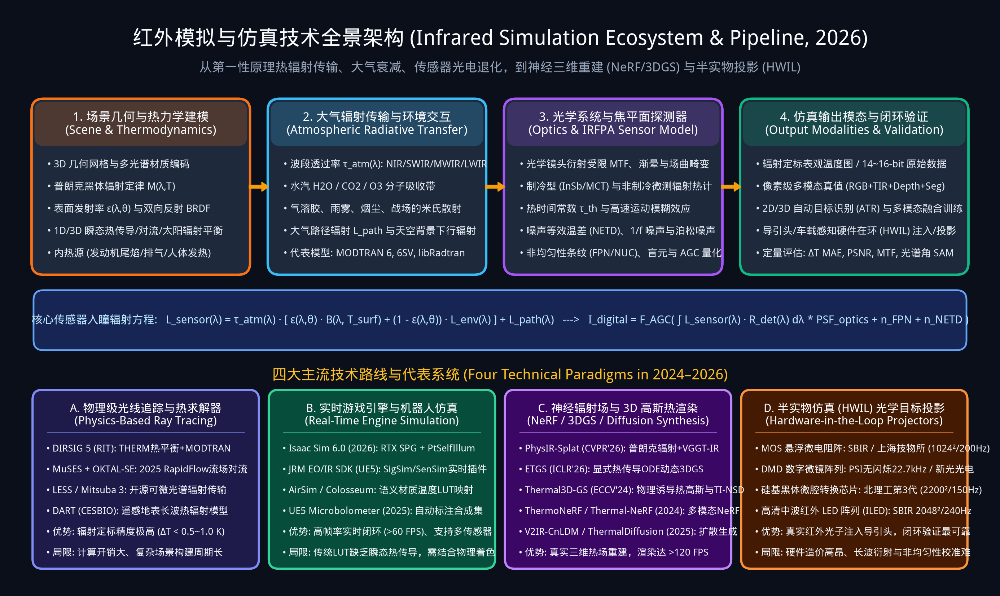
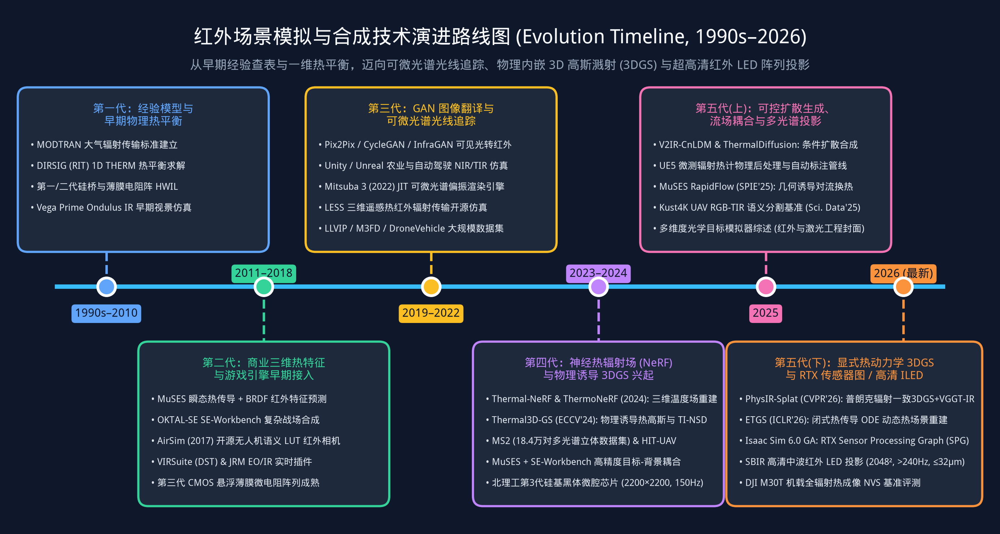
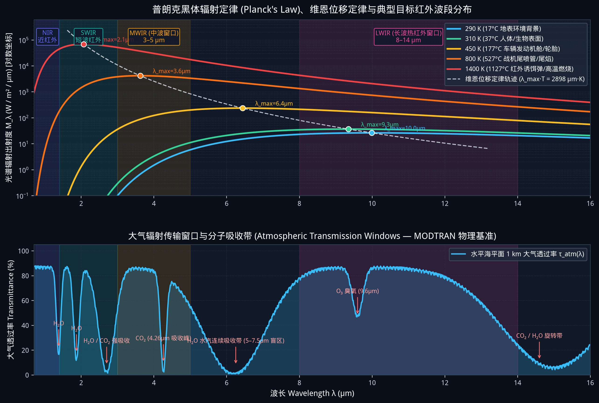
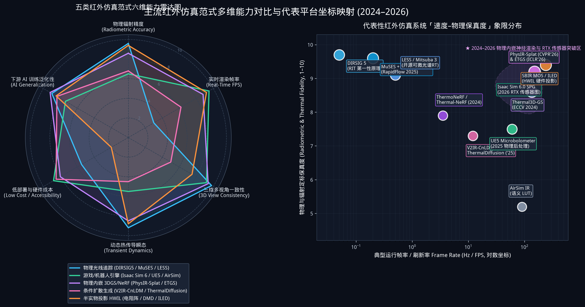
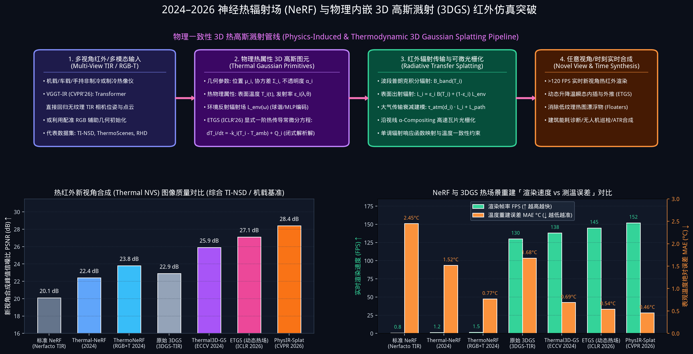
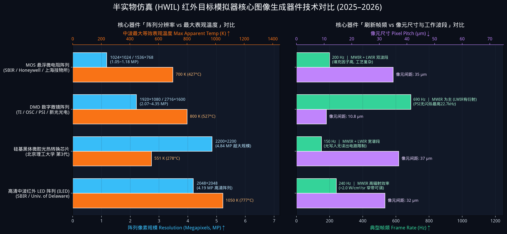

# Awesome-Infrared-Simulation (红外模拟与仿真技术全景综述 · 2026 更新版)

欢迎来到 **Awesome-Infrared-Simulation（红外模拟器与红外合成技术大全）**！本仓库旨在系统梳理、对比并持续追踪**红外场景仿真器（Infrared Scene Simulators）**、**物理级辐射传输与光线追踪引擎**、**神经热辐射场与 3D 高斯溅射（NeRF / 3DGS）**、**生成式可见光-红外图像转换（GAN / Diffusion）**、**半实物仿真（HWIL）光学目标投影系统**以及**主流多模态红外数据集**的最新进展（涵盖经典基础至 **2024–2026 年**前沿成果）。

Welcome to the **Awesome-Infrared-Simulation** repository! Whether you are an electro-optical engineer, autonomous driving / UAV perception researcher, or computer graphics enthusiast, this repository provides a comprehensive guide to physical, neural, and hardware-in-the-loop infrared simulation technologies.



---

## 目录 (Table of Contents)

- [1. 简介与技术演进 (Introduction & Evolution Timeline)](#1-简介与技术演进-introduction--evolution-timeline)
- [2. 红外仿真物理基础与成像链路 (Physical Foundations & Imaging Chain)](#2-红外仿真物理基础与成像链路-physical-foundations--imaging-chain)
- [3. 主流红外仿真范式对比 (Comparison of Infrared Simulation Paradigms)](#3-主流红外仿真范式对比-comparison-of-infrared-simulation-paradigms)
- [4. 软件级红外场景与传感器仿真器 (Software & Engine-Based IR Simulators)](#4-软件级红外场景与传感器仿真器-software--engine-based-ir-simulators)
  - [4.1 第一性原理与物理光线追踪渲染器 (Physics-Based & Ray-Tracing Engines)](#41-第一性原理与物理光线追踪渲染器-physics-based--ray-tracing-engines)
  - [4.2 实时游戏引擎与机器人仿真平台 (Real-Time Game & Robotics Engines)](#42-实时游戏引擎与机器人仿真平台-real-time-game--robotics-engines)
- [5. 近年前沿突破：神经渲染与生成式红外仿真 (2023–2026 Neural & Generative IR Simulation)](#5-近年前沿突破神经渲染与生成式红外仿真-20232026-neural--generative-ir-simulation)
  - [5.1 神经热辐射场 (Thermal NeRF, 2024)](#51-神经热辐射场-thermal-nerf-2024)
  - [5.2 物理诱导与热动力学 3D 高斯溅射 (Thermal 3D Gaussian Splatting, 2024–2026)](#52-物理诱导与热动力学-3d-高斯溅射-thermal-3d-gaussian-splatting-20242026)
  - [5.3 可控扩散模型与可见光-红外跨模态生成 (Diffusion & GAN RGB-to-TIR, 2023–2026)](#53-可控扩散模型与可见光-红外跨模态生成-diffusion--gan-rgb-to-tir-20232026)
- [6. 半实物仿真 (HWIL) 红外目标模拟器与投影器件 (Hardware-in-the-Loop Scene Projectors)](#6-半实物仿真-hwil-红外目标模拟器与投影器件-hardware-in-the-loop-scene-projectors)
- [7. 红外仿真与多模态感知基准数据集 (Datasets & Benchmarks)](#7-红外仿真与多模态感知基准数据集-datasets--benchmarks)
- [8. 经典与近年代表性论文导读 (Selected Papers & Literature)](#8-经典与近年代表性论文导读-selected-papers--literature)
- [9. 常见问题与讨论 (Discussions & FAQ)](#9-常见问题与讨论-discussions--faq)
- [10. 贡献指南与参考来源 (How to Contribute & Sources)](#10-贡献指南与参考来源-how-to-contribute--sources)

---

## 1. 简介与技术演进 (Introduction & Evolution Timeline)

红外仿真器（Infrared Simulators）在光电系统设计、自动目标识别（ATR）、无人机夜间巡检、自动驾驶全天候感知以及制导系统半实物闭环测试中扮演着核心角色。由于真实外场红外数据采集成本极高、气象与热边界条件不可控、且缺乏像素级温度/语义真值，高保真红外仿真成为算法验证与硬件测试的关键基础设施。

近几年（特别是 **2022–2026 年**），红外仿真技术经历了从**传统经验查表（LUT）/ 离线物理光线追踪**向**可微光谱渲染、物理内嵌三维高斯溅射（Physics-Induced & Thermodynamic 3DGS）、可控条件扩散模型（Conditional Diffusion）以及超高清中波红外 LED（ILED）阵列半实物投影**的跨越式演进：



---

## 2. 红外仿真物理基础与成像链路 (Physical Foundations & Imaging Chain)

与可见光（RGB）主要依赖外部光源反射不同，中波红外（**MWIR, 3–5 μm**）与长波热红外（**LWIR, 8–14 μm**）成像由**物体自身热辐射（Self-Emission）**与**环境反射辐射（Reflected Irradiance）**共同决定，并受到大气分子吸收与微测辐射热计（Microbolometer）/ 制冷光子探测器光电转换特性的强烈制约。



### 核心物理方程

1. **普朗克黑体辐射定律 (Planck's Law)**：温度为 $T$ 的黑体在波长 $\lambda$ 处的光谱辐射出射度为：
   $$M_{\lambda}(\lambda, T) = \frac{c_1}{\lambda^5 \left( \exp\left(\frac{c_2}{\lambda T}\right) - 1 \right)}$$
   其中第一辐射常数 $c_1 = 3.7418 \times 10^8\ \text{W}\cdot\mu\text{m}^4/\text{m}^2$，第二辐射常数 $c_2 = 1.4388 \times 10^4\ \mu\text{m}\cdot\text{K}$。

2. **斯蒂芬-玻尔兹曼定律 (Stefan–Boltzmann Law)** 与 **维恩位移定律 (Wien's Displacement Law)**：
   - 全波段积分辐射出射度与热力学温度四次方成正比：$M = \varepsilon \sigma T^4$（其中 $\varepsilon$ 为材料表面发射率，$\sigma \approx 5.67 \times 10^{-8}\ \text{W}\cdot\text{m}^{-2}\cdot\text{K}^{-4}$）。
   - 峰值辐射波长随温度升高向短波移动：$\lambda_{\max} \cdot T \approx 2897.8\ \mu\text{m}\cdot\text{K}$。因此 **290–310 K 常温地表与人体峰值位于 ~9.5–10 μm（LWIR 窗口）**，而 **500–1000 K 发动机尾喷管/尾焰峰值位于 3–5 μm（MWIR 窗口）**。

3. **传感器入瞳零视距与大气路径辐射传输方程**：
   $$L_{\text{sensor}}(\lambda, \theta) = \tau_{\text{atm}}(\lambda, d) \cdot \Big[ \varepsilon(\lambda, \theta) B(\lambda, T_{\text{surf}}) + \big(1 - \varepsilon(\lambda, \theta)\big) L_{\text{env}}(\lambda) \Big] + L_{\text{path}}(\lambda, d)$$
   其中 $\tau_{\text{atm}}(\lambda, d)$ 为距离 $d$ 处的大气透过率，$L_{\text{env}}(\lambda)$ 为天空与周围环境の下行/互反射辐射，$L_{\text{path}}(\lambda, d)$ 为大气路径程辐射。

---

## 3. 主流红外仿真范式对比 (Comparison of Infrared Simulation Paradigms)

当前红外模拟技术可分为五大主流范式，各自在**物理辐射定标精度、实时渲染帧率、三维多视角几何一致性、动态热传导瞬态建模**及**硬件成本**上具有显著权衡：



| 仿真范式 | 代表平台 / 框架 | 核心原理 | 典型帧率 | 辐射/温度精度 | 适用场景 |
| :--- | :--- | :--- | :--- | :--- | :--- |
| **第一性原理物理光线追踪** | `DIRSIG 5`, `MuSES` + `OKTAL-SE`, `LESS`, `Mitsuba 3`, `DART` | 3D 热传导/对流平衡求解 + 蒙特卡洛光谱路径追踪 + `MODTRAN` 大气 | 0.01 – 2 FPS (离线/准实时) | 极高 ($\Delta T < 0.5\text{–}1.0\text{ K}$) | 传感器论证、高价值目标红外隐身/特征预测、遥感定标 |
| **实时游戏/机器人引擎** | `Isaac Sim 6.0 (SPG)`, `JRM EO/IR (UE5)`, `VIRSuite`, `AirSim` | 材质温度编码 + 光栅化/RTX 自发光通道 (`PtSelfIllumination`) + 探测器噪声后处理 | 60 – 200+ FPS | 中–高 (取决于是否含瞬态热解算) | 无人机/自动驾驶多传感器闭环仿真、大规模合成数据自动标注 |
| **神经辐射场与物理 3DGS** | `PhysIR-Splat` (CVPR'26), `ETGS` (ICLR'26), `Thermal3D-GS`, `ThermoNeRF` | 将温度 $T$、发射率 $\varepsilon$、大气透过率与热传导 ODE 嵌入 3D 高斯或隐式场 | 120 – 150+ FPS (3DGS) / ~1 FPS (NeRF) | 高 ($\text{MAE} \approx 0.45\text{–}1.1^\circ\text{C}$) | 真实场景三维热数字孪生、新视角合成 (NVS)、动态热过程回放 |
| **条件生成与图像翻译** | `V2IR-CnLDM` ('25), `ThermalDiffusion` ('25), `Pix2Pix`, `CycleGAN` | 基于语义掩码/边缘/文本 ControlNet 引导潜在扩散或对抗网络将 RGB 转为 TIR | 5 – 30 FPS | 中 (统计视觉逼真，无严格能量守恒) | 缺乏红外采集条件下的自动驾驶/机器人视觉数据增强 |
| **半实物仿真 (HWIL) 投影** | `SBIR MOS/ILED`, `PSI DMD`, `北理工黑体微腔芯片`, `新光光电 DMD` | 物理微辐射元阵列或空间光调制器产生真实中/长波红外光子注入被测导引头 | 150 Hz – 22.7 kHz | 极高 (真实波段辐射功率输入) | 红外成像导引头、车载热像仪实验室半实物在环测试 |

---

## 4. 软件级红外场景与传感器仿真器 (Software & Engine-Based IR Simulators)

### 4.1 第一性原理与物理光线追踪渲染器 (Physics-Based & Ray-Tracing Engines)

#### 1. [DIRSIG 5 (Digital Imaging and Remote Sensing Image Generation)](https://dirsig.cis.rit.edu/docs/new/thermal.html)
- **研发机构**：美国罗切斯特理工学院 (RIT) DIRS 实验室
- **核心特性**：遥感与国防领域公认的第一性原理多光谱/高光谱/热红外光线追踪基准模型。内置 **THERM** 一维瞬态热平衡求解器（综合太阳辐照、天空长波背景、热传导、风速对流换热），亦可与外部三维有限元热求解器（如 `MuSES`）及大气辐射传输模型（`MODTRAN`）无缝耦合，支持焦平面扫描畸变、运动模糊与定量辐射通量输出。

#### 2. [MuSES™ (ThermoAnalytics)](https://www.thermoanalytics.com/product/muses/) & [OKTAL-SE SE-Workbench™](https://www.oktal-se.fr/high-fidelity-eo-ir-scene-simulation-using-muses-and-se-workbench/)
- **核心特性**：工业界高保真目标红外特征建模（`MuSES`）与大场景实时多模态合成（`SE-Workbench-IR`）黄金组合。
- **2024–2025 最新进展**：2024 年双方推出高分辨率目标热特征与复杂战场背景联合仿真流程；2025 年（SPIE 13673）`MuSES` 引入专用快速流体求解器 **RapidFlow**，在不牺牲全天候瞬态计算效率的前提下，精准模拟几何诱导的气流加速、尾流与局部对流换热系数，显著提升了车辆与飞行器表面表观温度预测精度。

#### 3. [LESS (Large-scale Emulation System for Forest/Scene Radiative Transfer)](https://github.com/jianboqi/lessrt) *(开源 GPL-3.0)*
- **官方网站**：[http://lessrt.org](http://lessrt.org) | **GitHub**：[jianboqi/lessrt](https://github.com/jianboqi/lessrt)
- **核心特性**：基于开源渲染引擎 `Mitsuba` 构建的三维辐射传输与热红外成像开源模拟器。支持大尺度复杂地形与植被冠层的上行/下行长波辐射模拟、多角度双向反射分布因子（BRF）以及新近引入的 **LESS3 可微辐射传输建模（Differentiable Radiative Transfer）**。

#### 4. [Mitsuba 3](https://github.com/mitsuba-renderer/mitsuba3) *(开源 BSD-3-Clause)*
- **研发机构**：瑞士洛桑联邦理工学院 (EPFL) RGL 实验室
- **核心特性**：基于 `Dr.Jit` 编译器的正向与逆向可微光谱/偏振光线追踪引擎。支持任意自定义波段的光谱辐射传输与 GPU OptiX 硬件加速，已成为近年科研界构建自定义物理热红外可微渲染器的首选底层底座。

#### 5. [DART (Discrete Anisotropic Radiative Transfer)](https://dart.omp.eu/)
- **研发机构**：法国图卢兹大学 CESBIO 实验室
- **核心特性**：支持从可见光到热红外（TIR）波段的城市与自然地表三维辐射预算及遥感影像模拟，被广泛用于卫星与机载热红外传感器定标验证。

---

### 4.2 实时游戏引擎与机器人仿真平台 (Real-Time Game & Robotics Engines)

#### 1. [NVIDIA Isaac Sim 6.0 — Sensor Processing Graph (SPG) 红外相机管线](https://github.com/isaac-sim/IsaacSim/discussions/298) *(2025–2026 最新特性)*
- **核心机制**：在 **Isaac Sim 6.0 GA** 中，通过 Omniverse Kit 级框架 **Sensor Processing Graph (SPG)** 与 RTX 光线追踪器结合，实现了模块化物理红外传感器建模：
  1. **材质温度辐射编码**：利用 `OmniPBR` 材质的自发光通道（Emissive）编码物体表面热力学温度与发射率；
  2. **纯净自辐射分离**：通过渲染变量 `PtSelfIllumination` AOV（或将 `HdrColor` 弹射次数设为 0）直接提取不受可见光漫反射污染的每像素热辐射信号；
  3. **SPG 探测器退化链路**：使用 Python 或 NVIDIA Warp GPU 核函数串联光谱响应曲线积分、镜头渐晕、微测辐射热计噪声等效温差（NETD）与非均匀性（FPN）模型（如模拟 FLIR Boson 640 / Hadron 机载双光吊舱）。

#### 2. [JRM EO/IR Sensor Plug-In & SDK (Unreal Engine)](http://jrmtech.com/unreal/)
- **核心特性**：基于 Unreal Engine 的商业级物理实时多光谱 EO/IR 传感器仿真插件，集成 JRM 的 `SigSim` 与 `SenSim` 运行时库，预测辐射精确、波段空间配准的 2D 传感器图像：

```text
Physics-based, dynamic environmental spectral irradiances & atmospherics
Spectral reflectance/specularity support
Physics-based volumetric and combustion effects (dust clouds, fires, smokes, flares, plumes)
Physics-based spectral man-made and natural light sources
On-the-fly transient thermal solutions & dynamic heating/cooling of vehicles
Full spatial correlation among wavebands
Design Blur, Diffraction MTFs, user defined MTFs, motion blur, detector blur, and 3rd order aberrations
Aero-optical effects & scanning effects
(1/f)n, Poisson, thermal, & fixed-pattern noise, detector non-uniformity, dead pixels, fill-factor
Pre/Post amplification control, AGC & photon transfer computing to produce detector counts output
```

#### 3. [VIRSuite (Visible and Infrared Suite)](https://www.dst.defence.gov.au/sites/default/files/publications/documents/DSC%201756%20Avalon%20Air%20Show%20VIR%20Suite.pdf)
- **研发机构**：澳大利亚国防科学技术集团 (DST Group)
- **核心特性**：用于实时生成复杂海陆空场景可见光与红外图像的综合性光电仿真评估软件，支持复杂干扰（红外诱饵弹、烟幕）与大气效应下的制导算法闭环评估。

#### 4. [AirSim](https://microsoft.github.io/AirSim/) / Colosseum
- **官方链接**：[AirSim Official](https://microsoft.github.io/AirSim/) | [Simulated Thermal Infrared (IR) 文档](https://microsoft.github.io/AirSim/InfraredCamera/)
- **核心特性与局限**：基于语义分割掩码（Segmentation Map）加上材质辐射温度查找表（LUT）生成热红外图像。计算极快，但由于缺乏材料内部热传导与太阳照射阴影瞬态温差，物体内部呈均匀灰度，直接用于训练深度学习检测器容易退化为单纯学习轮廓分割特征。


#### 5. [Unreal Engine 5 微测辐射热计物理模型与自动标注合成管线 (IEEE EIT 2025)](https://doi.org/10.1109/eit64391.2025.11103611)
- **核心特性**：在 Unreal Engine 中通过物理后处理材质模拟微测辐射热计（Microbolometer）探测机理，并集成 3D 包围盒向 2D 屏幕空间的自动投影标注工具。实验表明，采用 80%–95% 合成红外数据配合少量 FLIR 真实红外数据训练 YOLOv8，即可在行人、动物等恒温发热目标上取得与纯真实数据集相当的检测精度（mAP）。

---

## 5. 近年前沿突破：神经渲染与生成式红外仿真 (2023–2026 Neural & Generative IR Simulation)

2024 至 2026 年，红外仿真领域最大的学术与工程突破在于将**热辐射传输方程与热传导偏微分方程（PDE/ODE）显式嵌入神经辐射场（NeRF）与三维高斯溅射（3D Gaussian Splatting, 3DGS）**，从而彻底解决了传统三维重建在低纹理红外图像上的“漂浮物伪影（Floaters）”与“缺乏物理温度一致性”难题，同时将渲染帧率推升至 **130–150+ FPS**。



### 5.1 神经热辐射场 (Thermal NeRF, 2024)

1. **[Thermal-NeRF: Neural Radiance Fields from an Infrared Camera](https://arxiv.org/html/2403.10340)** *(2024)*
   - **代码与数据集**：[Cerf-Volant425/Thermal-NeRF](https://github.com/Cerf-Volant425/Thermal-NeRF)
   - **核心贡献**：首个仅依赖单目/多视角热红外相机重建三维体积辐射场的方法。针对热像仪缺乏纹理与高频边缘的痛点，提出**热辐射映射（Thermal Mapping）**与**结构化热约束（Structural Thermal Constraint）**，在夜间及烟尘遮挡等可见光失效场景下实现稳健的三维重建。

2. **[ThermoNeRF: Joint RGB and Thermal Novel View Synthesis for Building Facades](https://arxiv.org/abs/2403.12154)** *(2024)*
   - **核心贡献**：面向建筑能耗诊断与基础设施无损检测的多模态 NeRF。利用配对的 RGB 与热红外图像共享学习场景几何密度（解决纯热图像几何歧义），并通过解耦分支网络分别预测视角相关的可见光颜色与视角无关的表观温度场。在配套公开的 **ThermoScenes**（16 个建筑立面与日常物体场景）上将温度估计平均绝对误差（MAE）降至 **$0.41^\circ\text{C}\text{–}1.13^\circ\text{C}$**（较拼接基线提升超 50%）。

---

### 5.2 物理诱导与热动力学 3D 高斯溅射 (Thermal 3D Gaussian Splatting, 2024–2026)

1. **[Thermal3D-GS: Physics-induced 3D Gaussians for Thermal Infrared Novel-view Synthesis](https://arxiv.org/html/2409.08042)** *(ECCV 2024)*
   - **核心贡献**：首次将物理热传导与大气传输效应引入 3D 高斯溅射。通过神经网络建模三维介质中的大气衰减与热传导偏移，并在损失函数中引入**温度一致性约束（Temperature Consistency Constraint）**，有效消除低对比度红外场景中的漂浮物与边缘模糊。
   - **基准数据集 TI-NSD**：同步开源首个大规模热红外新视角合成基准数据集 **TI-NSD**（涵盖室内、室外及无人机 UAV 视角的 20 个真实热红外视频场景，共 **6,664 帧**），PSNR 较基线提升 **3.03 dB**。

2. **[PhysIR-Splat: Physically Consistent Thermal Infrared Radiative Transfer in 3D Gaussian Splatting](https://github.com/JingyuanGao0919/physir-splat)** *(CVPR 2026, 开源 MIT)*
   - **代码仓库**：[JingyuanGao0919/physir-splat](https://github.com/JingyuanGao0919/physir-splat)
   - **核心贡献**：在每个三维高斯图元上严格建模热红外物理成像链路：**波段普朗克自身辐射（Passband Planck Radiance）+ 环境反射辐射（Environmental Reflection）$\rightarrow$ 大气透过率衰减（Atmospheric Transmittance）$\rightarrow$ 视线 $\alpha$-合成 $\rightarrow$ 单调辐射响应映射**。同时提出基于 Transformer 的无纹理热红外位姿与点云初始化器 **VGGT-IR**，无需依赖 COLMAP 在可见光上的失败配准即可直接从多视角热红外图像完成物理一致的三维热场重建。

3. **[ETGS: Explicit Thermodynamic 3D Gaussian Splatting for Dynamic Thermal Scenes](https://proceedings.iclr.cc/paper_files/paper/2026/file/befcb9fa78d078b6a06cf6f2ecf3a70d-Paper-Conference.pdf)** *(ICLR 2026)*
   - **核心贡献**：针对随时间演化的动态升温、冷却与传热过程，为每个 3D 高斯赋予显式热物理参数，并用**一阶热传导常微分方程（ODE）及其解析闭式解（Analytical Closed-Form Solution）**描述温度随时间的演化。无需数值积分即可在任意连续时间戳实现超高速动态热渲染，并配套发布毫秒级同步的 **Rapid Heat Dynamics (RHD)** 数据集。

4. **[Evaluation of Novel View Synthesis in Radiometric Drone Imagery](https://www.scitepress.org/Papers/2026/144609/144609.pdf)** *(2026)*
   - **核心贡献**：基于 **DJI M30T** 无人机采集的全辐射定标机载双光（RGB + Radiometric TIR）数据集，系统评测了 `Thermal-NeRF`、`ThermoNeRF`、`Thermal3D-GS` 与通用 `Nerfacto`/`gsplat`，验证了 `Thermal3D-GS` 在机载辐射测温三维重建中的最优综合性能（PSNR 22.99 dB, SSIM 0.845）。

---

### 5.3 可控扩散模型与可见光-红外跨模态生成 (Diffusion & GAN RGB-to-TIR, 2023–2026)

当缺乏三维资产或实测热像仪时，利用生成式模型将存量可见光数据集（或 CARLA 等自动驾驶仿真器的 RGB 输出）转换为热红外图像是低成本数据扩增的重要途径：

- **[V2IR-CnLDM](https://doi.org/10.1117/1.oe.64.9.092206)** *(Optical Engineering, 2025)*：基于 **ControlNet 引导的条件潜在扩散模型（Conditional Latent Diffusion Model）**，结合空间几何约束与文本提示词（描述目标发热状态与环境气象），将 RGB 图像转换为物理合理的合成 TIR 图像，显著提升下游红外目标检测器性能。
- **[ThermalDiffusion: Visual-to-Thermal Image-to-Image Translation for Autonomous Navigation](https://arxiv.org/html/2506.20969)** *(2025)*：利用自注意力条件扩散网络学习真实世界常见目标（行人、车辆、植被、道路）的热特征分布，为自动驾驶与移动机器人扩充夜间/雾天热红外训练数据。
- **[CARLA + Ensemble RGB-to-IR Translation](https://www.mdpi.com/2313-433X/11/7/206)** *(Journal of Imaging, 2025)*：直接利用 `CARLA (v0.9.15)` 导出的高精度语义分割掩码与 RGB 图像，结合在 `MS2` 与 `Freiburg` 数据集上训练的转换模型，快速合成城市自动驾驶多模态 NIR 与热红外场景（MS2 上 $R^2=0.98$，Freiburg 上 PSNR 达 $21.3\text{ dB}$）。
- **[Termatics/rgb2themal](https://github.com/Termatics/rgb2themal)** *(开源)*：基于 `Pix2Pix`（配对）与 `CycleGAN`（非配对，结合 AirSim/UE 虚拟场景与真实 IR 数据集）的可见光转热红外训练框架。

---

## 6. 半实物仿真 (HWIL) 红外目标模拟器与投影器件 (Hardware-in-the-Loop Scene Projectors)

在红外制导武器导引头与高端车载光电系统的研制闭环中，软件生成的数字红外图像必须通过**光学目标模拟器（Optical / Infrared Scene Projector, IRSP）**转换为真实的动态红外光学辐射信号，经准直光学系统投射至被测传感器入瞳。

根据 2024–2026 年最新行业进展（参见《红外与激光工程》2025 年封面特邀综述[《光学目标模拟器综述》](https://www.spacejournal.cn/hwyjggc/cn/article/pdf/preview/10.3788/IRLA20250037.pdf)及 SBIR / IEEE RAPID 最新报告），四大核心红外图像生成器件的技术指标对比如下：



| 核心器件类型 | 工作机制 | 代表研制机构 | 主流分辨率规模 | 典型帧频 | 最大表观温度 (MWIR) | 核心优势与技术瓶颈 |
| :--- | :--- | :--- | :--- | :--- | :--- | :--- |
| **MOS 悬浮微电阻阵列**<br>*(Resistor Array)* | CMOS 驱动电路控制流过第三代悬浮薄膜微电阻电流发热辐射 | 美国 SBIR (`MIRAGE XL`/`OASIS`)、Honeywell、中科院上海技物所 | $1024 \times 1024$ /<br>$1536 \times 768$ | $200\text{ Hz}$ | $>700\text{ K}$ (MWIR)<br>$>600\text{ K}$ (LWIR) | **优势**：中/长波双波段覆盖、温度分辨率高 ($<40\text{ mK}$)、填充因子高。<br>**瓶颈**：MEMS+CMOS 工艺极复杂、造价昂贵、坏点与非均匀性 ($<5\%$) 校准要求高。 |
| **DMD 数字微镜阵列**<br>*(Digital Micromirror Device)* | 微铝镜绕对角线偏转 $\pm 12^\circ$，通过 PWM 脉宽调制反射黑体光源 | 美国 TI (芯片)、OSC、PSI、哈尔滨新光光电 | $1280 \times 1024$ ~<br>$1920 \times 1080$ /<br>$2716 \times 1600$ | $200\text{–}690\text{ Hz}$<br>(PSI 无闪烁达 $22.7\text{ kHz}$) | $785\text{–}1800\text{ K}$<br>(取决于黑体/激光源) | **优势**：像元尺寸小 (~$10.8\ \mu\text{m}$)、成本较低、高对比度 ($>250:1$)。<br>**瓶颈**：需与导引头积分时间严格同步；长波红外 ($8\text{–}12\ \mu\text{m}$) 接近像元尺寸导致衍射损失显著。 |
| **硅基黑体微腔光热转换芯片**<br>*(Visible-to-IR Chip)* | 写入可见光被硅微腔内“双 S”悬浮微桥吸收并快速升温辐射红外 | 北京理工大学 (光电学院目标仿真实验室) | $2200 \times 2200$<br>(第 3 代超大规模) | $150\text{ Hz}$<br>(液氮背冷散热) | $550.8\text{ K}$<br>(范围 $293.5\text{–}550.8\text{ K}$) | **优势**：无 CMOS 读出电路像元尺寸限制、阵列规模极大 ($4.84\text{ MP}$)、中长波宽谱段辐射。<br>**瓶颈**：极限高温与超高速瞬态受微桥热容与热应力制约。 |
| **高清中波红外 LED 阵列**<br>*(IR LED / ILED Array)* | 超晶格量子阱半导体电致发光直接发射中波红外光子 | 美国 SBIR、特拉华大学 (Univ. of Delaware) | $512 \times 512 \rightarrow$<br>$2048 \times 2048$ (研发目标) | $>240\text{ Hz}$ | $>1000\text{ K}$ 等效<br>($>2.0\text{ W/cm}^2/\text{sr}$) | **优势**：电光响应极快（纳秒至微秒级）、窄带带内辐射效率极高、像素间距 $\le 32\ \mu\text{m}$。<br>**瓶颈**：目前主要集中于中波红外 (MWIR)，长波量子效率与大面阵互联良率仍在突破中。 |

> **多维度光学目标模拟器新趋势 (2025–2026)**：除传统二维图像式红外模拟器外，融合**光谱维度调控**（如 Kent Optronics 基于手性液晶 CLC 与 LCOS 的多光谱目标模拟器）以及融合**距离回波延时维度**的**红外+激光雷达复合三维目标模拟器**正在成为多模复合制导与 L3/L4 自动驾驶硬件在环测试的前沿方向。

---

## 7. 红外仿真与多模态感知基准数据集 (Datasets & Benchmarks)

高质量的真实与半合成多模态红外数据集是训练生成式红外仿真器、评测三维热场重建（NeRF/3DGS）以及验证 Sim-to-Real 泛化能力的基石：

| 数据集名称 | 发布年份 | 采集平台与模态 | 数据规模与分辨率 | 核心任务与特点 | 链接 |
| :--- | :--- | :--- | :--- | :--- | :--- |
| **RHD (Rapid Heat Dynamics)** | **2026** (ICLR) | 毫秒级同步 RGB + 热红外相机 | 多组瞬态加热/冷却/传热动态序列 | **动态 3DGS 热力学重建基准**，捕捉快速非稳态热传导过程 | [Paper (ICLR'26)](https://proceedings.iclr.cc/paper_files/paper/2026/file/befcb9fa78d078b6a06cf6f2ecf3a70d-Paper-Conference.pdf) |
| **Kust4K** | **2025** (Sci. Data) | 专业六旋翼无人机 (HET-3021C) 双光同步 | 4,024 对像素级配准 RGB ($1920\times 1080$) + TIR ($640\times 512$) | **无人机城市交通 RGB-TIR 语义分割**，覆盖多光照与复杂道路场景 | [Nature Sci. Data](https://www.nature.com/articles/s41597-025-05994-7) |
| **TI-NSD** | **2024** (ECCV) | 室内、室外及 UAV 机载真实热像仪 | 20 个真实热红外视频场景，共 **6,664 帧** | **首个大规模热红外新视角合成 (Thermal NVS) 基准数据集** | [Paper (arXiv)](https://arxiv.org/html/2409.08042) |
| **ThermoScenes** | **2024** | 手持配准 RGB + 辐射定标热像仪 | 8 个建筑立面场景 + 8 个日常物体多视角序列 | **多模态三维温度场重建与绝对测温误差 (°C MAE) 评测** | [Paper (arXiv)](https://arxiv.org/abs/2403.12154) |
| **MS² (Multi-Spectral Stereo)** | **2023–2025** | 车载立体 RGB + 立体 NIR + 立体 Thermal + LiDAR + IMU | **16.2 万–18.4 万对**全天候（晨/昼/夜/晴/云/雨）多模态帧 | **热红外深度估计、跨光谱立体匹配与 RGB-to-IR 仿真训练基准** | [GitHub](https://github.com/UkcheolShin/SupDepth4Thermal) |
| **HIT-UAV** | **2023** (Sci. Data) | 高空无人机热红外相机 (含飞行高度/俯仰角元数据) | 2,898 张精选热红外图像（自 43,470 帧视频提取），24,899 个标注框 | **高空无人机红外小目标检测**（提供旋转框 OBB 与水平框 HBB） | [Paper PDF](https://xingzhou.ac.cn/pdf/suo-Sdata-HIT-UAV23.pdf) |
| **UAV-RGB-T-2400** | **2023** | DJI Mavic 2 Enterprise Advanced 双光无人机 | 2,400 对时空同步 RGB ($1920\times 1080$) + TIR ($640\times 512$) | 校园、道路、林地及航空模型多场景 RGB-T 目标检测 | [GitHub](https://github.com/VDT-2048/UAV-RGB-T-2400) |
| **M³FD & LLVIP** | **2021–2022** | 双目配准可见光 + 远红外相机 | M³FD: 4,200 对；LLVIP: 15,488 对（低照度行人） | 图像融合、跨模态图像翻译（GAN/Diffusion）与全天候目标检测经典基准 | [LLVIP GitHub](https://github.com/bupt-ai-cz/LLVIP) |

---

## 8. 经典与近年代表性论文导读 (Selected Papers & Literature)

### 2024–2026 前沿论文 (Recent Breakthroughs)

1. **[PhysIR-Splat: Physically Consistent Thermal Infrared Radiative Transfer in 3D Gaussian Splatting](https://github.com/JingyuanGao0919/physir-splat)** *(CVPR 2026)*
   - 将波段普朗克黑体辐射、方向发射率、环境反射辐射与大气透过率统一到 3D 高斯图元中，并提出 `VGGT-IR` 解决无纹理红外图像位姿初始化难题。
2. **[ETGS: Explicit Thermodynamic 3D Gaussian Splatting](https://proceedings.iclr.cc/paper_files/paper/2026/file/befcb9fa78d078b6a06cf6f2ecf3a70d-Paper-Conference.pdf)** *(ICLR 2026)*
   - 将一阶热传导微分方程解析闭式解嵌入 3DGS，实现任意时刻动态升降温过程的实时高保真渲染。
3. **[光学目标模拟器综述 (Review of Optical Scene Projector)](https://www.spacejournal.cn/hwyjggc/cn/article/pdf/preview/10.3788/IRLA20250037.pdf)** *(《红外与激光工程》2025 年第 6 期封面文章，高彦泽、李卓等，北京理工大学)*
   - 全面综述红外（电阻阵、DMD、硅基黑体微腔光热转换芯片）、紫外、可见光、多光谱及激光雷达三维目标模拟器的工作原理、核心技术指标与国内外最新研制进展。
4. **[Improving MuSES EO/IR Target and Background Scene Simulation Accuracy with the RapidFlow Fluid Solver](https://digitalcommons.mtu.edu/michigantech-p2/2224/)** *(SPIE 2025, Packard et al.)*
   - 提出专为室外大尺度红外特征预测设计的快速流场求解器 `RapidFlow`，精确捕捉三维几何诱导的对流换热变化。
5. **[Synthetically Generated IR Image Data for Training Deep Learning Models and Application to Object Detection](https://doi.org/10.1109/eit64391.2025.11103611)** *(IEEE EIT 2025)*
   - 在 Unreal Engine 中构建基于物理的微测辐射热计红外传感器后处理模型与 3D-to-2D 自动标注管线，验证合成数据与真实 FLIR 数据混合训练 YOLOv8 的有效性。
6. **[V2IR-CnLDM](https://doi.org/10.1117/1.oe.64.9.092206) & [ThermalDiffusion](https://arxiv.org/html/2506.20969)** *(2025)*
   - 探索基于 ControlNet 与自注意力条件潜在扩散模型的可控可见光-热红外跨模态合成。
7. **[Thermal3D-GS](https://arxiv.org/html/2409.08042) (ECCV 2024) / [Thermal-NeRF](https://arxiv.org/html/2403.10340) (2024) / [ThermoNeRF](https://arxiv.org/abs/2403.12154) (2024)**
   - 开启三维神经辐射场与物理诱导 3D 高斯溅射在热红外三维重建与新视角合成领域的先河。

---

### 经典基础论文 (Foundational & Domain Papers)

#### [Simulation of near Infrared Sensor in Unity for Plant-weed Segmentation Classification](https://www.scitepress.org/Papers/2020/98279/98279.pdf) *(2020)*
Weed spotting through image classification is one of the methods applied in precision agriculture to increase efficiency in crop damage reduction. These classifications are nowadays typically based on deep machine learning with convolutional neural networks (CNN), where a main difficulty is gathering large amounts of labeled data required for the training of these networks. Thus, synthetic dataset sources have been developed including simulations based on graphic engines; however, some data inputs that can improve the performance of CNNs like the near infrared (NIR) have not been considered in these simulations. This paper presents a simulation in the Unity game engine that builds fields of sugar beets with weeds. Images are generated to create datasets that are ready to train CNNs for semantic segmentation. The dataset is tested by comparing classification results from the Bonnet CNN network trained with synthetic images and trained with real images, both with RGB and RGBN (RGB+near infrared) as inputs. The preliminary results suggest that the addition of the NIR channel to the simulation for plant-weed segmentation can be effectively exploited, showing a difference of 5.75% for the global mean IoU over 820 classified images by including the NIR data in the Unity generated dataset.

#### [Tensorial properties via the neuroevolution potential framework: Fast simulation of infrared and Raman spectra](https://arxiv.org/abs/2312.05233) *(2023)*
Infrared and Raman spectroscopy are widely used for the characterization of gases, liquids, and solids, as the spectra contain a wealth of information concerning in particular the dynamics of these systems. Atomic scale simulations can be used to predict such spectra but are often severely limited due to high computational cost or the need for strong approximations that limit application range and reliability. Here, we introduce a machine learning (ML) accelerated approach that addresses these shortcomings and provides a significant performance boost in terms of data and computational efficiency compared to earlier ML schemes. To this end, we generalize the neuroevolution potential approach to enable the prediction of rank one and two tensors to obtain the tensorial neuroevolution potential (TNEP) scheme, implemented in the free and open source software package `GPUMD` for predicting infrared and Raman spectra of liquid water, molecules, and anharmonic crystals.

#### [Dynamic Infrared Simulation: A Feasibility Study of a Physically Based Infrared Simulation Model](http://www.diva-portal.org/smash/get/diva2:22896/FULLTEXT01.pdf)
The increased usage of infrared sensors by pilots has created a growing demand for simulated environments based on infrared radiation. This has led to an increased need for Saab to refine their existing model for simulating real-time infrared imagery, resulting in the carrying through of this thesis for Gripen aircraft training simulators. The thesis develops and evaluates a physically based infrared simulation model with dynamically changeable attributes (such as time of day and weather conditions) integrated into real-time pilot training environments.

---

## 9. 常见问题与讨论 (Discussions & FAQ)

- **[为什么 AirSim 等早期游戏引擎的 LUT 红外模拟难以直接用于深度学习检测器训练？](https://stackoverflow.com/questions/76872875/how-to-simulate-ir-vision-in-unreal-engine)**
  - 早期引擎仅将语义类别映射为固定灰度值（Look-Up Table），忽略了真实热成像中的**材料热容差异、太阳辐照方向引起的受光/背光面温差、发动机内部热源传导梯度以及微测辐射热计的非均匀性条纹（FPN）与 NETD 噪声**。
  - **2024–2026 改进方案**：
    1. 在渲染管线中使用 `Isaac Sim 6.0 SPG` 或 `UE5` 自定义微测辐射热计材质，引入局部热分布纹理与传感器光电退化链路；
    2. 结合 `PhysIR-Splat` / `Thermal3D-GS` 从真实机载/车载红外视频重建高保真三维热场，以任意新视角合成逼真训练样本；
    3. 使用 `V2IR-CnLDM` 或 `ThermalDiffusion` 对齐合成几何边缘与真实红外热纹理分布。

- **斯蒂芬-玻尔兹曼定律 (Stefan–Boltzmann Law) 参考图解**：
  The [Stefan–Boltzmann law](https://en.wikipedia.org/wiki/Stefan%E2%80%93Boltzmann_law), also known as Stefan's law, describes the intensity of the thermal radiation emitted by matter in terms of that matter's temperature.


---

## 10. 贡献指南与参考来源 (How to Contribute & Sources)

我们非常欢迎社区贡献新的开源红外仿真器、物理材质库、神经热渲染代码及公开数据集！请遵循以下步骤提交贡献：

1. Fork 本仓库 (`Awesome-Infrared-Simulation`)。
2. 创建具有描述性的特性分支（例如 `git checkout -b feat/add-new-ir-simulator`）。
3. 在相应章节补充仿真器、论文或数据集说明，并附上官方链接与核心技术指标。
4. 提交更改并创建 Pull Request (PR)。

### Sources & References
1. [DIRSIG Thermal Modality Handbook — Rochester Institute of Technology](https://dirsig.cis.rit.edu/docs/new/thermal.html)
2. [MuSES & OKTAL-SE High-Fidelity EO/IR Scene Simulation](https://www.thermoanalytics.com/product/muses/)
3. [LESS: Large-scale Emulation System for Forest/Scene Radiative Transfer](https://github.com/jianboqi/lessrt) & [Mitsuba 3](https://github.com/mitsuba-renderer/mitsuba3)
4. [PhysIR-Splat (CVPR 2026)](https://github.com/JingyuanGao0919/physir-splat), [ETGS (ICLR 2026)](https://proceedings.iclr.cc/paper_files/paper/2026/file/befcb9fa78d078b6a06cf6f2ecf3a70d-Paper-Conference.pdf), [Thermal3D-GS (ECCV 2024)](https://arxiv.org/html/2409.08042)
5. [高彦泽, 陆俊杰, 李仁杰, 穆远, 李卓. 光学目标模拟器综述 (封面文章·特邀) [J]. 红外与激光工程, 2025, 54(6): 20250037.](https://www.spacejournal.cn/hwyjggc/cn/article/pdf/preview/10.3788/IRLA20250037.pdf)
6. [Development of a High-Definition IR LED Scene Projector — Santa Barbara Infrared (SBIR)](https://sbir.com/wp-content/uploads/2026/09/Development-of-a-High-Definition-IR-LED-Scene-Projector-1.pdf)
7. [GitHub - othneildrew/Best-README-Template](https://github.com/othneildrew/Best-README-Template)
8. [A simple README.md template · GitHub](https://gist.github.com/PurpleBooth/109311bb0361f32d87a2)
